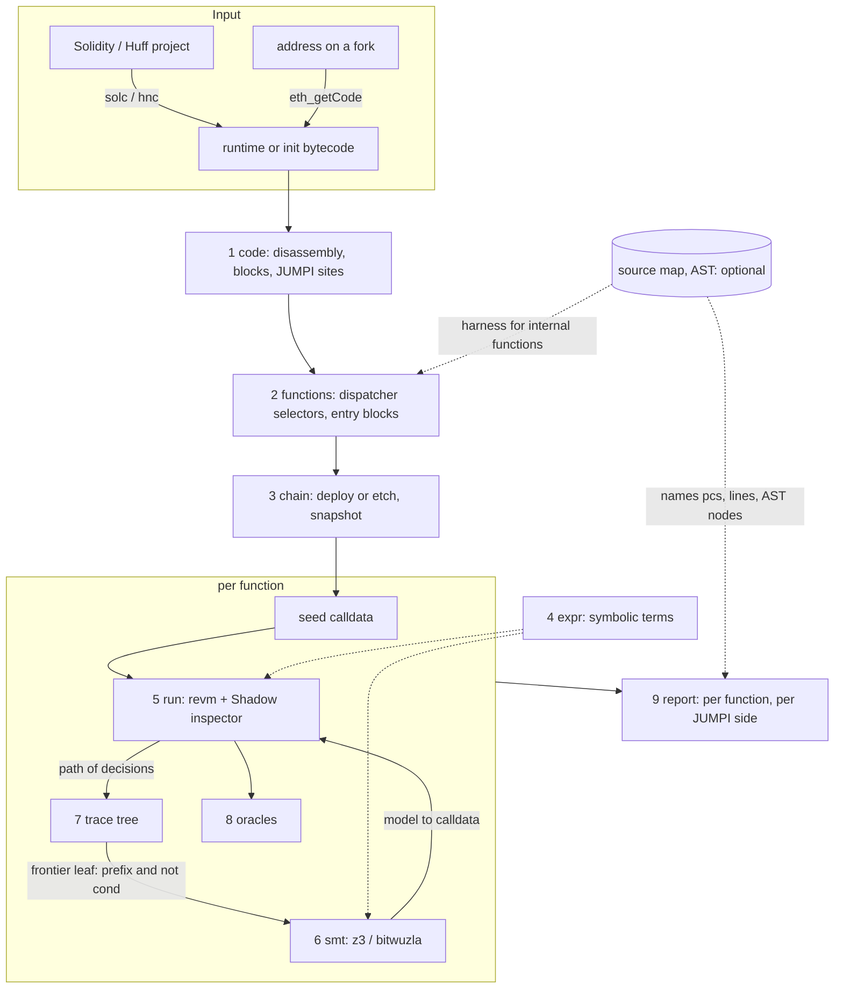
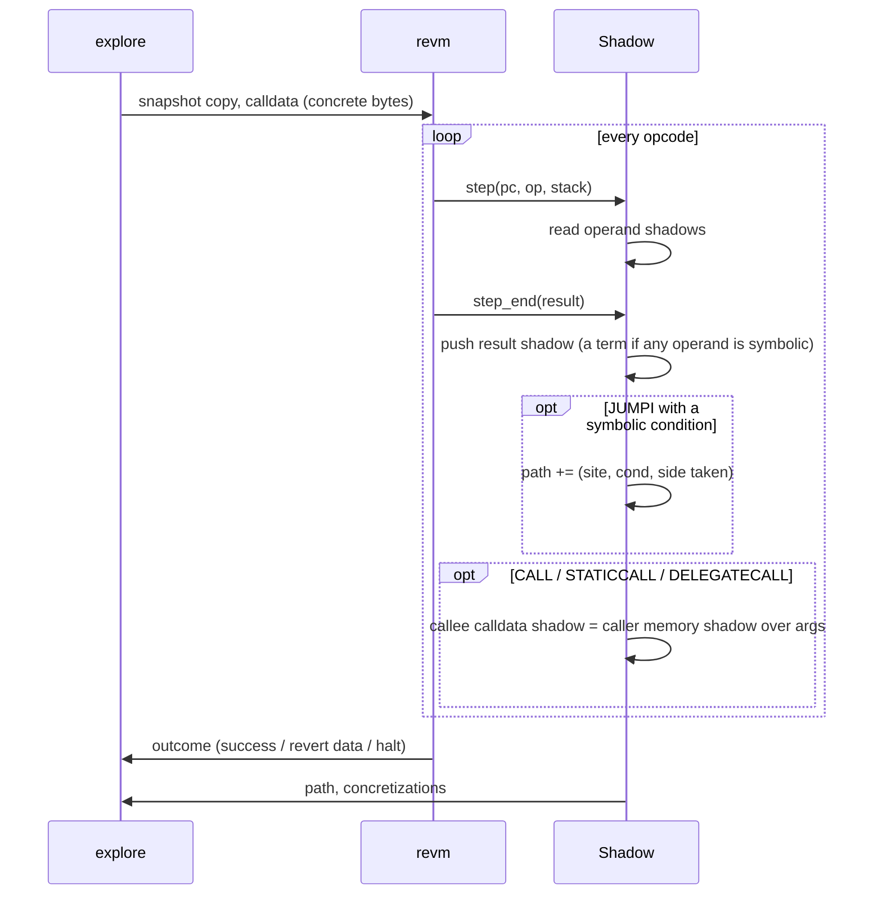
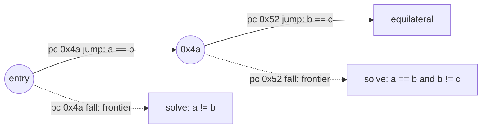

# Architecture

**Bytecode is the program.** concolity explores EVM bytecode. Its functions are the selectors the dispatcher
answers. Its branches are the `JUMPI`s. Coverage is counted by pc. That works the same for Solidity (inline assembly
included), Yul, Huff, Vyper, and a contract deployed on a fork with no source at all.

**Source is a helper.** When a source map is available (solc's, or hnc's for Huff), each pc is mapped back to a
line and, for Solidity, an AST node. The AST then adds names and expectations: "this `JUMPI` is `require(a > 0)`",
"this one is the overflow check of `a + b`", and it lets internal functions be exposed directly. Nothing in the core
depends on it.

[DESIGN.md](DESIGN.md) says why concolic. This file says how the program is put together.



## 1. `code`: what the bytecode contains

- **Disassembly**: instructions, push data skipped, valid `JUMPDEST`s, and the metadata trailer solc appends (CBOR)
  cut off.
- **Basic blocks** and a static CFG: a `PUSH <dest> JUMP(I)` edge is resolved statically. Dynamic jumps (solc's
  internal-function returns, Huff's jump tables) are resolved by the runs, and the CFG grows as edges are seen.
- **Branch sites**: every `JUMPI`, with two sides, `jump` and `fall`. This is the coverage universe. A site that
  no run reaches is *unreached*. One that a run reaches with a concrete condition is *concrete-only*: the inputs
  can't change it.

```rust
struct Code { bytes: Bytes, hash: B256, ops: Vec<Op>, blocks: Vec<Block>, jumpis: Vec<usize> /* pcs */ }
struct Site { code: B256, pc: usize }
enum Side { Jump, Fall }
```

## 2. `functions`: entry points from the dispatcher

- **Static scan** of the dispatcher: solc's `PUSH4 sel EQ PUSH dest JUMPI` (and `GT` binary-search splits), Vyper's
  and Huff's equivalents. That gives `selector → entry pc`.
- **Dynamic check**: the scan is only a hint. Each selector is run once, and the selectors that reach code past the
  dispatcher are the functions. With no selectors found, the whole contract is one function (fallback or
  calldata-driven Huff).
- **Arguments**: with an ABI (solc's output, `--sig 'f(uint256,address)'`, or 4byte), calldata is sized and decoded
  by it. Without one, the calldata is `selector ‖ N symbolic bytes`. N grows when a run reads past the end
  (`CALLDATALOAD` beyond `CALLDATASIZE` is a hint), and `CALLDATASIZE` itself can be symbolic.
- **Internal functions** are regions of the bytecode reached through their callers. A function's coverage is the
  sites its runs reach. With source, a harness can expose internals as selectors of their own (§10).

```rust
struct Function { selector: Option<[u8; 4]>, entry: usize, abi: Option<Vec<DynSolType>>, name: Option<String> }
```

## 3. `chain`: where it runs

- revm 43 over `CacheDB<Backend>`, sol-debug's backend, so a fork works the same way.
- Runtime bytecode is **etched** at an address. Init bytecode is **deployed** (with `--ctor` arguments). A project is
  compiled and deployed through `sol_debug::Session`.
- After setup the state is snapshotted, and **every run starts from the snapshot**: runs are independent.

## 4. `expr`: symbolic terms

A hash-consed arena of 256-bit bitvector terms. Identical subterms are shared, and constructors fold constants and the
patterns compilers emit (`x + 0`, `iszero(iszero(c))`, 32 byte-extracts of one word concatenated back).

```rust
struct ExprId(u32);
enum Expr {
    Const(U256),
    Var(VarId),                         // calldata byte i, CALLDATASIZE, CALLVALUE, CALLER, TIMESTAMP, …
    Bin(BinOp, ExprId, ExprId),         // ADD SUB MUL DIV SDIV MOD SMOD EXP AND OR XOR SHL SHR SAR LT GT SLT SGT EQ BYTE SIGNEXTEND
    Not(ExprId), IsZero(ExprId),
    Concat(Vec<ExprId>),                // bytes → word (CALLDATALOAD, MLOAD)
    Extract { e: ExprId, byte: u8 },    // word → byte (MSTORE, MSTORE8)
    Ite(ExprId, ExprId, ExprId),
    AddMod(ExprId, ExprId, ExprId), MulMod(ExprId, ExprId, ExprId),
}
```

## 5. `run`: one transaction under the Shadow inspector



- **Shadow state** per frame, where `None` means concrete only: stack `Vec<Option<ExprId>>`, memory (byte-granular map),
  calldata, return data. Storage shadows per (address, slot) come later, for sequences.
- **Not modelled** (`KECCAK256`, `BALANCE`, `EXTCODE*`, precompiles, …): the result is concrete.
- **Concretization**: a symbolic memory offset, size, jump target, call target or exponent is replaced by its value.
  `expr == value` goes into the path, flagged, so solutions stay sound.

```rust
struct Decision { site: Site, cond: ExprId, taken: Side, concretized_before: bool }
struct Run { calldata: Bytes, path: Vec<Decision>, reached: BTreeSet<(Site, Side)>, outcome: Outcome }
enum Outcome { Return(Bytes), Revert(Bytes), Halt(HaltReason) }   // INVALID (0xfe) is a Halt
```

## 6. `smt`: solving

- SMT-LIB2, `QF_BV`: one 8-bit constant per calldata byte, terms printed as `let`-shared DAGs. EVM semantics are
  written out where they differ from SMT-LIB's: `div x 0 = 0`, `sdiv(-2^255, -1)`, shifts by 256 or more.
- One long-lived `z3 -in` (or `bitwuzla`) process: `push`, assert, `check-sat` under a timeout, `get-value`, `pop`.
- A model becomes calldata. Bytes the model leaves free keep the parent run's values, so solutions stay near their
  seed.

## 7. `tree`: what to solve next

The Fuzzing Book's `TraceTree`, one per function.



- A node is a decision at a site. A run is inserted as a walk from the root. Each side not taken is a **frontier
  leaf**, and its query is the path from the root to its parent plus the flipped condition.
- A leaf ends as `Solved(run)`, `Unsat`, `Timeout`, or `UnsatConcretized` (unsat only under a concretized prefix,
  so not a proof).
- **Ranking**: first a side of a site no run has taken, then fewer concretizations, then shallower. A global
  `(site, side)` set skips leaves another path already covered.

## 8. `oracles`: findings, from the bytecode alone

- revert data `Panic(uint256)` (`0x4e487b71`): `0x01` assert, `0x11` overflow, `0x12` division by zero, `0x21`,
  `0x31`, `0x32`;
- `INVALID` (`0xfe`): solc's old asserts, Huff's and Yul's explicit invalid;
- a function marked must-not-revert (`--no-revert check`) reverting;
- later: property functions (`invariant_*`, `check_*`), balance checks on a fork, sequences.

## 9. `report`

By function, then by `JUMPI` site, then by side: the input that takes it, or `unsat`, `timeout`, `concretized`.
Findings come with their calldata. `report.json`, and one replay JSON per solution for sol-debug.

```
0x8f0d282d check(int256,int256,int256)                    18/20 sides, 1 finding
  pc 0x0153 jump  calldata …0000 0001 …   ok
            fall  calldata …0000 0000 …   revert Error("not a side")
  pc 0x01a2 fall  calldata …7fff…ffff …   Panic(0x11)              FINDING
  pc 0x0210 jump  unsat
```

## 10. The source layer (optional)

When the bytecode came from a project, sol-debug's `CodeMap` maps each site to its source:

- **Solidity**: file, line, AST node. Then:
  - Sites get names: `IfStatement` true/false, `require` pass/fail, checked `+` ok/overflow.
  - The AST's own branch list (formal-ast's `guards` and `arith`, plus `if`, `?:`, `&&`, `||` and loops) is compared
    with the sites. An AST branch with no `JUMPI` was folded by the optimizer. One whose sites were never reached is
    uncovered, by line.
  - Internal and library functions with ABI-encodable parameters get a generated harness
    (`contract XHarness is X { function exposed_f(…) external … }`), so they become selectors of their own.
- **Huff**: lines and macro names where hnc gives a map.
- **Inline assembly** needs nothing extra: it is bytecode like the rest, and its sites map to the `assembly` block's
  lines.

The same report, with the layer:

```
Triangle.check(int256,int256,int256)                      18/20 sides, 1 finding
  Triangle.sol:22  require(a > 0 && …)   pass a=1 b=1 c=1 · fail a=0 b=0 c=0 "not a side"
  Triangle.sol:23  a + b                 ok …             · Panic(0x11) a=2^255-1 b=1   FINDING
```

## Code layout

```
src/
  main.rs       CLI: concolity explore <0xhex | file.bin | project file.sol | --fork url --at addr> [--sig …]
  code.rs       1   disassembly, blocks, JUMPI sites, metadata trailer
  functions.rs  2   dispatcher scan, dynamic check, calldata shapes
  chain.rs      3   etch / deploy, snapshot
  expr.rs       4
  shadow.rs     5   the Inspector
  smt.rs        6
  tree.rs       7
  oracle.rs     8
  report.rs     9
  source.rs    10   CodeMap, AST names, harness (behind the `source` feature)
  explore.rs        seed → run → insert → pick → solve → run
fixtures/  tests/
```

Dependencies: `revm` 43, `alloy-dyn-abi`, `clap`, `serde_json`, `anyhow`. `sol-debug` and `formal-ast`, for the
source layer and for compiling projects. The solver is an external binary.

## First cut

1. `expr`, `smt`: terms, SMT-LIB, z3, tested on hand-built terms.
2. `code`, `chain`, `shadow`: Triangle's **runtime bytecode** etched, one run with symbolic calldata, its path printed
   by pc.
3. `tree`, `explore`: `triangle` with every reachable side covered, all 5 of the book's paths, by pc only.
4. `functions`: selectors found from the dispatcher, so `concolity explore 0x…` covers every function with no ABI.
5. Frames and oracles: `check`'s calls into `triangle`, the non-triangle reverts, and the `a + b` overflow found.
6. The source layer: the same report by line and AST node, then harnesses for internal functions.
