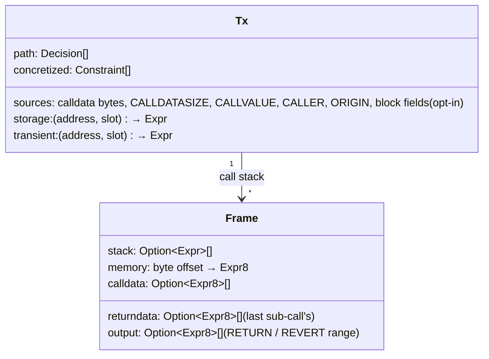

# The EVM model: every opcode, symbolically

revm runs every opcode for real. concolity only has to say, for each opcode, what the **symbolic shadow** of its
result is, and what it does to the shadow memory, storage, calldata and return data. This file is that model for
all 150 opcodes of the current mainnet fork (Osaka, with `CLZ`). EOF opcodes aren't on mainnet and aren't modelled.
Bytes that aren't opcodes behave like `INVALID`.

## Shadow state



`None` means the value is concrete only. Every symbolic value also has its concrete value, which revm computed.

There are four kinds of model:

| Model | Meaning |
|---|---|
| **exact** | the result is a term over the operands' terms, equal to the EVM result for every input |
| **source** | the result is a fresh variable (an input): calldata, callvalue, caller, and opt-in block fields |
| **concrete** | the result has no shadow. Symbolic operands are **concretized**: `operand == value` is added to the path, flagged |
| **effect** | the op moves shadows between stack, memory, storage, calldata and return data |

Concretizing keeps every solution sound: a solution satisfies the run's concretizations, so the run replays exactly
up to the flipped branch. It costs completeness: a branch that needs a different value of a concretized operand is
reported `concretized`, never `unsat`.

## Terms

Words are 256-bit bitvectors. Booleans stay booleans inside the arena (`Lt(a, b)` is a `Bool` term) and become words
(`ite(c, 1, 0)`) only when used as numbers. So `ISZERO(ISZERO(LT(a, b)))` folds back to `LT(a, b)`, and `JUMPI`
asserts a boolean directly. Memory and calldata are bytes (`Expr8`). A word read from memory is `concat` of 32 bytes.
A word written is 32 `extract`s. `concat(extract(w, 0..32))` folds back to `w`, so word-aligned ABI code makes small
terms.

## The opcodes

Operands are written as on the stack, top first: `a, b` = `a` on top.

### Arithmetic

| op | name | model | term (SMT-LIB, `QF_BV`) |
|---|---|---|---|
| `0x01` | ADD | exact | `bvadd a b` |
| `0x02` | MUL | exact | `bvmul a b` |
| `0x03` | SUB | exact | `bvsub a b` |
| `0x04` | DIV | exact | `ite (= b 0) 0 (bvudiv a b)`: SMT-LIB's `bvudiv x 0` is all ones, the EVM's is 0 |
| `0x05` | SDIV | exact | `ite (= b 0) 0 (bvsdiv a b)`: `bvsdiv MIN -1 = MIN`, as in the EVM |
| `0x06` | MOD | exact | `ite (= b 0) 0 (bvurem a b)` |
| `0x07` | SMOD | exact | `ite (= b 0) 0 (bvsrem a b)`: the sign follows `a` in both |
| `0x08` | ADDMOD | exact | `ite (= n 0) 0 (extract 255 0 (bvurem (bvadd (zext 1 a) (zext 1 b)) (zext 1 n)))`, at 257 bits |
| `0x09` | MULMOD | exact | the same at 512 bits with `bvmul` |
| `0x0a` | EXP | exact when the exponent is concrete: square-and-multiply, at most 2·256 `bvmul`s. Symbolic exponent with base 2: `ite (bvult e 256) (bvshl 1 e) 0`. Base 0 or 1: `ite`. Otherwise the exponent is concretized |
| `0x0b` | SIGNEXTEND | exact when `b` is concrete: `ite (bvult b 31) (sign_extend from bit 8b+7) x`. Symbolic `b`: concretized |

### Comparison and bitwise

| op | name | model | term |
|---|---|---|---|
| `0x10` | LT | exact | `bvult a b` (Bool) |
| `0x11` | GT | exact | `bvugt a b` |
| `0x12` | SLT | exact | `bvslt a b` |
| `0x13` | SGT | exact | `bvsgt a b` |
| `0x14` | EQ | exact | `= a b` |
| `0x15` | ISZERO | exact | `= a 0`, or `not c` when `a` is a Bool word |
| `0x16` | AND | exact | `bvand a b` |
| `0x17` | OR | exact | `bvor a b` |
| `0x18` | XOR | exact | `bvxor a b` |
| `0x19` | NOT | exact | `bvnot a` |
| `0x1a` | BYTE | exact | `i` concrete: `zext (extract x at byte i)`, or 0 when `i ≥ 32`. `i` symbolic: `ite (bvult i 32) (bvand (bvlshr x (bvmul (bvsub 31 i) 8)) 0xff) 0` |
| `0x1b` | SHL | exact | `bvshl x s` (`s` is on top). SMT-LIB gives 0 for shifts ≥ 256, like the EVM |
| `0x1c` | SHR | exact | `bvlshr x s` |
| `0x1d` | SAR | exact | `bvashr x s`: the sign fills for shifts ≥ 256, like the EVM |
| `0x1e` | CLZ | exact | binary search: 8 nested `ite`s on `bvult x 2^k` |

### Hashing

| op | name | model |
|---|---|---|
| `0x20` | KECCAK256 | Offset and length are concretized. Concrete input: no shadow. Symbolic input: a fresh variable `h_i`. Its concrete value is the real hash, and the path gets `input_i == concrete input` only when a branch depends on `h_i`. Two hashes of symbolic inputs get `(= in_i in_j) ⇒ (= h_i h_j)`. A branch on `h_i` itself (a mapping slot compared, a commitment) is reported `needs-preimage`, not solved |

### Environment

| op | name | model |
|---|---|---|
| `0x30` | ADDRESS | concrete |
| `0x31` | BALANCE | concrete (address concretized) |
| `0x32` | ORIGIN | source when `--sym origin`, else concrete |
| `0x33` | CALLER | source in the top frame when `--sym caller` (with `bvult caller 2^160`), else concrete. In sub-frames it is the calling contract: concrete |
| `0x34` | CALLVALUE | source in the top frame for payable functions (`--sym value`, bounded by the sender's balance), else concrete. Sub-frames: the CALL's value operand shadow |
| `0x35` | CALLDATALOAD | effect: `concat` of the 32 calldata byte shadows from `off` (offset concretized). Bytes past `CALLDATASIZE` are 0, or `ite (bvult (off+i) size) byte_i 0` when the size is symbolic |
| `0x36` | CALLDATASIZE | concrete, or a source in no-ABI mode (`4 ≤ size ≤ max`) |
| `0x37` | CALLDATACOPY | effect: calldata byte shadows → memory (dest, offset, length concretized) |
| `0x38` | CODESIZE | concrete |
| `0x39` | CODECOPY | effect: clears the memory shadow over the range (code is concrete) |
| `0x3a` | GASPRICE | concrete |
| `0x3b` | EXTCODESIZE | concrete (address concretized) |
| `0x3c` | EXTCODECOPY | effect: clears the memory range (address concretized) |
| `0x3d` | RETURNDATASIZE | concrete (a callee's symbolic output length is concretized at its RETURN) |
| `0x3e` | RETURNDATACOPY | effect: return data byte shadows → memory |
| `0x3f` | EXTCODEHASH | concrete (address concretized) |

### Block

| op | name | model |
|---|---|---|
| `0x40` | BLOCKHASH | concrete (number concretized) |
| `0x41` | COINBASE | concrete |
| `0x42` | TIMESTAMP | source with `--sym timestamp` (≥ the snapshot's timestamp), else concrete |
| `0x43` | NUMBER | source with `--sym number` (≥ the snapshot's), else concrete |
| `0x44` | PREVRANDAO | source with `--sym prevrandao`, else concrete |
| `0x45` | GASLIMIT | concrete |
| `0x46` | CHAINID | concrete |
| `0x47` | SELFBALANCE | concrete, plus the CALLVALUE shadow when the value is symbolic: `bvadd balance_before value` |
| `0x48` | BASEFEE | concrete |
| `0x49` | BLOBHASH | concrete |
| `0x4a` | BLOBBASEFEE | concrete |

### Stack, memory, storage, flow

| op | name | model |
|---|---|---|
| `0x50` | POP | effect: pop the shadow |
| `0x51` | MLOAD | effect: `concat` of 32 memory byte shadows (offset concretized). Bytes never written are 0 |
| `0x52` | MSTORE | effect: 32 `extract`s of the value's shadow into memory (offset concretized) |
| `0x53` | MSTORE8 | effect: the low byte's shadow |
| `0x54` | SLOAD | effect: the `(address, slot)` shadow if this transaction wrote a symbolic value there; else concrete, or a source with `--sym-storage` (slot concretized) |
| `0x55` | SSTORE | effect: `(address, slot) ← value shadow` (slot concretized). Reverted frames roll their writes back |
| `0x56` | JUMP | concrete (a symbolic destination is concretized) |
| `0x57` | JUMPI | **the branch**: the destination is concretized. A symbolic condition appends `Decision { site, cond, side }` |
| `0x58` | PC | concrete |
| `0x59` | MSIZE | concrete (offsets are concrete, so memory size is too) |
| `0x5a` | GAS | concrete; a branch on gas is marked `gas-dependent` |
| `0x5b` | JUMPDEST | nothing |
| `0x5c` | TLOAD | effect: like SLOAD over transient storage |
| `0x5d` | TSTORE | effect: like SSTORE, cleared at the end of the transaction |
| `0x5e` | MCOPY | effect: memory shadows copied (through a temporary, so overlap is right) |
| `0x5f`–`0x7f` | PUSH0–PUSH32 | concrete (constants) |
| `0x80`–`0x8f` | DUP1–DUP16 | effect: copy the shadow |
| `0x90`–`0x9f` | SWAP1–SWAP16 | effect: swap the shadows |
| `0xa0`–`0xa4` | LOG0–LOG4 | none (offsets concretized); topics and data shadows kept on the run for oracles |

### Calls and creation

| op | name | model |
|---|---|---|
| `0xf0` | CREATE | value and init-code range concretized; symbolic init-code bytes are concretized; the new address is concrete |
| `0xf5` | CREATE2 | as CREATE, salt concretized |
| `0xf1` | CALL | gas, address, value, and both ranges concretized. **The callee frame's calldata = the caller's memory shadows over args.** On return: the success flag is concrete, the caller's return data = the callee's output shadows, written into memory over the out range |
| `0xf2` | CALLCODE | as CALL |
| `0xf4` | DELEGATECALL | as CALL, no value; the callee's storage shadows are the caller's (same address) |
| `0xfa` | STATICCALL | as CALL, no value |
| `0xf3` | RETURN | effect: frame output = memory shadows over the range |
| `0xfd` | REVERT | as RETURN, then the frame's storage and transient shadow writes are rolled back |
| `0x00` | STOP | effect: empty output |
| `0xfe` | INVALID | halt; an oracle finding |
| `0xff` | SELFDESTRUCT | beneficiary concretized |

**Precompiles** (`0x01`–`0x11`, and `0x100` P256VERIFY) run concretely. The input range is concretized, and the output has no shadow, except
`0x04` identity, whose output shadows are its input shadows. Solidity uses it for memory copies.

## What the model doesn't follow

- **Gas.** Costs depend on values (memory expansion, `EXP`, cold or warm access), and a solved input can run out of
  gas where its parent didn't. Every solution is re-run concretely before it counts. Branches on `GAS` are
  `gas-dependent`.
- **Code, balances, other accounts**: concrete in this version. Balances become sources with fork-level
  exploration.
- **Hash preimages**: see KECCAK256. That is the honest limit of any SMT-based tool.

## How the model is checked

The model is the part that must not be wrong, so it's checked three ways:

1. **Self-check on every run** (debug builds, and `--check-model`). After each op, the result's term is evaluated on
   the concrete values of its variables. It must equal the stack top revm left. The same goes for memory words
   written by effects. A mismatch stops the run and names the op, the operands and both values.
2. **Per-opcode solver tests.** For each exact op, z3 proves `term(a, b) = evm(a, b)` for fixed concrete operands
   and checks edge vectors: 0, 1, `2^255`, `2^256 - 1`, shift 255, 256, 257, `MIN / -1`. The EVM reference is revm's
   own instruction implementation, run on a one-op program.
3. **ethereum/tests VMTests**, with all inputs symbolic: every test still runs to the same result, and the
   self-check passes on every step.

## Code

```
src/evm/
  mod.rs       the 256-entry table: opcode → Model
  arith.rs     0x01–0x0b
  bits.rs      0x10–0x1e
  env.rs       0x30–0x4a sources and concretes
  memory.rs    byte-shadow memory, calldata, return data, copies
  storage.rs   storage and transient shadows, rollback on revert
  frames.rs    call / create / return / revert plumbing, precompiles
  check.rs     term evaluation and the self-check
```

`Model` is an enum: `Exact(fn(&mut Arena, &[Shadow]) -> Shadow)`, `Source(SourceKind)`,
`Concrete { concretize: &'static [usize] }` (which operands), and `Effect(EffectKind)`. Every byte maps to a
model, so no opcode is ever missing.
