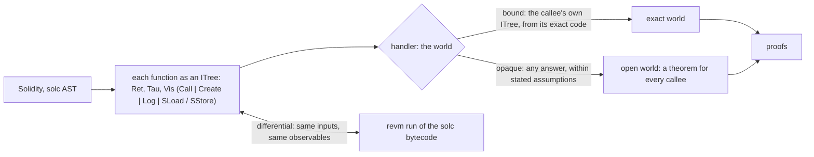
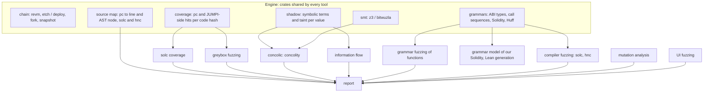
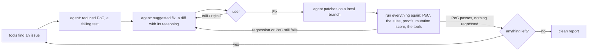
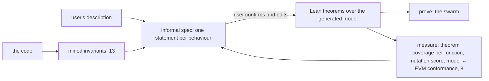

# Roadmap: the auditor's playground

concolity is the first tool. The plan is a set of them, one per testing technique, all built on the same engine.
Each tool works as a binary and as an agent skill. Their results go into one report per codebase, and Formal Mind's
agents act on that report: they write a PoC, suggest a fix, apply it when the user clicks Fix, and run everything
again until nothing is left.

Most techniques come from [The Fuzzing Book](https://www.fuzzingbook.org) and its companion,
[The Debugging Book](https://www.debuggingbook.org), moved onto the EVM and its compilers.

## Two modes

The toolkit works in two modes, and the user picks per project:

- **Testing mode, no Lean.** Coverage, concolic, fuzzing, mutation, information flow, and the agent debugger,
  all on bytecode in revm. Fast, and nothing to learn. Findings come with a PoC and a fix.
- **Lean mode.** The same code also gets a semantics in Lean, and properties are proved, not only tested.

Lean mode builds on [solidity-lean](https://github.com/paradigmxyz/solidity-lean) (Paradigm's SolidCore). It is an
executable semantics of Solidity in Lean 4 that imports, type-checks, lowers and interprets single-contract programs,
and checks the results byte for byte against solc and the EVM through a forge replay corpus. Its v1 leaves out what
real protocols need most: external calls, contract creation and inline assembly. We add those with **interaction
trees** (ITrees):

- **A call is an event, not a step.** A function's ITree stops at `Vis (Call to data)` and continues with whatever
  the call returns. The semantics of one contract doesn't need to know its callees.
- **The handler is the binding.** It interprets the events:
  - *exact*: run the bound callee's ITree. The binding table from `concolity coverage` says which code that is, so
    it is the same code the tests ran;
  - *open*: any return within stated assumptions (a token that may return false, a hook that may reenter). A theorem
    proved against the open handler holds for every callee, which is how reentrancy and hostile tokens get proved
    rather than tested.
- **Checked against the EVM, like SolidCore.** The ITree semantics runs on the same inputs as revm, and the observables
  must match: return data, revert data, events, storage. concolity generates those inputs: one per path it can solve,
  so conformance is checked on every branch, not on samples. A divergence is a bug in the model.
- **What it replaces.** formal-ast's Lean generator, which translates each contract into its own model and links
  them through `Ext`, becomes ITree-based. The bindings it does today (by selector, hooks, raw calls) become handlers.

## The shared engine

Everything below needs the same few things, and concolity already has most of them:

## The techniques

| # | Tool | Book chapter | What it gives an auditor | Built on |
|---|---|---|---|---|
| 1 | **solc coverage** | Code Coverage | Line, statement and **branch-side** coverage of a Foundry suite, without forge's slow coverage build (forge recompiles with the optimizer off and instruments everything). We compile **once** with solc and the project's own settings, run the tests in revm with a hit-counting inspector, and map pcs back through the source map. So it measures the bytecode that ships. | sol-debug's test runner and source maps, a bitset per code hash |
| 2 | **concolic** (concolity) | Concolic Fuzzing | An input for each branch a fuzzer can't reach, or a proof that no input can | the shadow, z3 |
| 3 | **mutation-based fuzzing** | Mutation-Based Fuzzing | Calldata and call sequences mutated from seeds (tests, fork transactions): bit flips, interesting values (0, 1, max, boundaries), splicing | coverage as feedback |
| 4 | **greybox fuzzing** | Greybox Fuzzing | Coverage-guided fuzzing with power schedules (AFLFast): seeds that reach rare branches get more energy. Works on **bytecode only**, so on unverified contracts, on a fork | 1 + 3, the bytecode core |
| 5 | **search-based fuzzing** | Search-Based Fuzzing | For arithmetic windows (`a * b / c == d + 1`): branch distance as fitness, hill climbing. Cheaper than the solver when terms are nonlinear | coverage, `JUMPI` operand values |
| 6 | **grammar fuzzing of functions** | Fuzzing with Grammars, Grammar Coverage | ABI types and call sequences as grammars: structured inputs (orders, signatures, nested structs) and sequences that cover every expansion (deposit → swap → cancel → claim, in every order) | the ABI, formal-ast's units |
| 7 | **compiler fuzzing** (solc, hnc) | Fuzzing with Grammars, Greybox, Grammar Coverage | Programs generated from the Solidity and Huff grammars, compiled and **run**. The oracle is differential: the same program under optimizer on and off, viaIR and legacy, two solc versions, and a Huff port against its Solidity original, must behave the same in revm. The binaries are fuzzed with coverage too: solc has `test/tools/ossfuzz` libFuzzer harnesses, and hnc is Rust (`cargo-fuzz`) | grammars, chain, coverage of native code |
| 8 | **a grammar model of our Solidity**, and Lean | Grammar Coverage | The subset of Solidity that formal-ast's Lean generator supports, written as a grammar. Programs generated from it are (a) compiled and run in revm, and (b) translated to Lean and evaluated. They must agree. This tests the **Lean model against the EVM**, so a proof about the model is a proof about the bytecode. Grammar coverage says which constructs that has been checked for | grammars, formal-ast, chain |
| 9 | **information flow** | Tracking Information Flow | Taint from untrusted sources (calldata, caller, oracle answers, other contracts' return data) to sinks: a `CALL` target or value, a `DELEGATECALL`, a storage slot index, a transfer amount, `SELFDESTRUCT`. A cheap mode of the shadow: taint bits, no terms | the shadow |
| 10 | **mutation analysis** | Mutation Analysis | Mutants of the contract (flip a comparison, drop a guard, Floor ↔ Ceil, ±1). A mutant that survives every test and proof is a hole in the tests or the spec. **The mutation score is the spec's strength** | formal-ast's AST rewrites, 1 |
| 11 | **UI fuzzing** | Testing Web Applications, Testing GUIs | The dapp's interface driven by a grammar of user actions. Oracles: console errors, a transaction the UI builds that reverts in simulation, quotes the contract wouldn't honour | a browser driver, chain (simulation) |
| 12 | **reducing PoCs** | Reducing Failure-Inducing Inputs (delta debugging) | Every failing input and call sequence shrunk to the smallest one that still fails, before a human reads it | chain |
| 13 | **mining specifications** | Mining Function Specifications | Invariants seen in every run (Daikon-style: `total == Σ balances`, `price > 0 after update`), offered as informal specs to confirm | coverage traces, named storage |
| 14 | **carving tests** | Carving Unit Tests | A fork transaction turned into a standalone Foundry test, so a real-world call becomes a regression test | sol-debug's replay |
| 15 | **failure origins** | Tracking Failure Origins (dynamic slicing) | For a revert or a broken invariant: the statements and inputs it depends on | the shadow, source map |
| 16 | **when to stop** | When To Stop Fuzzing | A Good-Turing estimate of how likely the next run finds something new, in the report, so "we fuzzed it" comes with a number | coverage over time |

## One report per codebase

Each tool writes its results to `audit/` in the repo (local first: no GitHub issues or PRs). The report puts them
together:

- **findings**: each with a reduced PoC (a Foundry test that fails for the stated reason), the technique that found
  it, its source location, and a suggested fix;
- **coverage**: by line and by branch side, with each uncovered side explained as solved, unsat (dead), timeout or
  concretized;
- **spec strength**: the mutation score, and theorem coverage per function (Proofs);
- **confidence**: when-to-stop estimates per campaign.

## The fix loop

Suggesting a fix is the step that matters most: a finding without a fix is half the work.

Rules for the loop:

- a fix is accepted only when its PoC passes and **nothing regresses**: every earlier test and proof still passes,
  and the mutation score doesn't drop;
- each fix adds its PoC as a regression test;
- agents commit to a local branch. The user merges.

## Informal specs to formal specs

The user describes what the protocol should do, in their own words. The agents help them say it precisely, and turn
it into Lean:

The measures say when the spec is strong enough:

- every function has its behaviours stated;
- every mutant is killed by some proof or test;
- the Lean model agrees with the EVM on the grammar-generated programs.

## Order

1. **solc coverage** (1): the slow-coverage pain today, and the feedback signal for 3, 4, 5 and 16. *Built:*
   `concolity coverage`, with bindings and missing bytecode first; the agent debugger (`concolity debug`) came with it.
2. **concolity's explore loop** (2): the trace tree, so it explores on its own. Then reduction (12) for its findings.
   *Built:* the explore loop, and reduction of each finding's inputs over ABI values (`src/reduce.rs`: numbers to 0,
   then bisection to the boundary, then bit clearing; lists by ddmin; booleans and addresses to their simplest).
3. **Mutation-based and greybox fuzzing** (3, 4), on bytecode, sharing 1's coverage. Unverified contracts on a
   fork.
4. **Grammar fuzzing of functions** (6), with the hybrid: greybox runs until coverage plateaus, then concolity
   solves the stuck branches.
5. **Information flow** (9), as a cheap mode of the shadow.
6. **The report and the fix loop**, in Formal Mind, over 1–6 and 12.
7. **Mutation analysis** (10) and **mined specs** (13), feeding informal → formal specs.
8. **The grammar model of our Solidity and Lean conformance** (8), then **compiler fuzzing** (7).
9. **UI fuzzing** (11), **carving** (14), **failure origins** (15), **when to stop** (16).

Each step is one tool, a CLI and a skill, tested on a fixture first and then on asyncswap/contracts.
