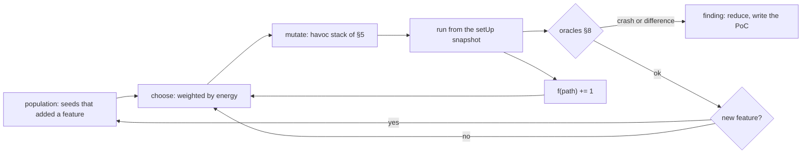

# concolity fuzz: inputs that make the bytecode crash or behave differently

**Same rule as the rest of concolity: only the code counts.** `concolity fuzz` runs the bytecode solc produced, in
revm, with the project's own setUp and cheatcodes. It generates call sequences and keeps the ones that reach new
bytecode. It has two goals:

- **crash**: a run ends in a Panic, an `INVALID`, a broken invariant, or a revert the harness says can't happen;
- **behave differently**: the same sequence, run on two builds of the same contracts, gives different observable
  results.

Each finding comes back as a reduced sequence and a Foundry test that reproduces it.

This is step 3 of [ROADMAP.md](../ROADMAP.md) (mutation-based and greybox fuzzing, techniques 3 and 4), with the hybrid
of step 4. It ships in desktop 0.2.0 with the hunter, from formalmind's `release/0.2`.

## 1. Why, and why now

[HUNTING.md](../HUNTING.md) says where the tools stall:

- **Reach.** On Async Swap at 3295d4d, 1,272 untaken sides were never reached by any fuzz test's arguments, and 269
  more ran but didn't depend on the inputs. `updatePrice`'s branches depend on stored order state. Solving one call's
  arguments can't get there. A sequence of calls can.
- **No campaign runner.** `concolity coverage` skips every `invariant_*` test ("invariant campaign"). The
  matching-engine hunt had to run forge's campaigns in the background. Those campaigns are where sequence bugs live
  (submit, partial fill, reprice, cancel, match).
- **No second build to compare with.** A fix, an optimizer setting, a solc upgrade or a Huff port is a second program
  that should behave like the first. Nothing runs both on the same inputs today.

Echidna, Medusa and forge invariants already fuzz sequences. What concolity adds:

1. Coverage measured on the bytecode that ships (optimizer on), counted per `JUMPI` side and mapped to AST nodes.
2. The hand-off to `explore` when coverage stops growing. z3 solves the guard the fuzzer is stuck behind, and the
   solved input goes back into the corpus.
3. The differential oracle, built in.

## 2. The model: The Fuzzing Book, chapter by chapter

| Fuzzing Book chapter | The book's piece | In concolity fuzz |
|---|---|---|
| [Fuzzing](https://www.fuzzingbook.org/html/Fuzzer.html) | `Runner`, `RandomFuzzer` | `Harness::run(sequence)` on sol-debug's runner, from the setUp snapshot. coverage's `Rng::value` is the random fuzzer over ABI types |
| [Code Coverage](https://www.fuzzingbook.org/html/Coverage.html) | `Coverage` as a set of lines | a set of **features** per run: `JUMPI` sides with bucketed hit counts, and call edges (§4) |
| [Mutation-Based Fuzzing](https://www.fuzzingbook.org/html/MutationFuzzer.html) | `delete/insert/flip_random_character`, `MutationCoverageFuzzer` keeps inputs with new coverage | mutators on sequences and on ABI values (§5). A run that adds a feature joins the population |
| [Greybox Fuzzing](https://www.fuzzingbook.org/html/GreyboxFuzzer.html) | `Seed`, `PowerSchedule`, `AFLFastSchedule`, `CountingGreyboxFuzzer`, `DirectedSchedule` | the same classes. A path id is the hash of a run's feature set. AFLFast energy is `1 / f(path)^e`. The directed schedule weights seeds by distance to a `--target` line (§6) |
| [Greybox Fuzzing with Grammars](https://www.fuzzingbook.org/html/GreyboxGrammarFuzzer.html) | structural mutation, splicing two seeds | the ABI and the sequence are the grammar: mutate one call's typed argument, splice two seeds' sequences at a call boundary |
| [Search-Based Fuzzing](https://www.fuzzingbook.org/html/SearchBasedFuzzer.html) | branch distance as fitness | later (§9): the operands of an untaken `JUMPI`'s comparison as a distance, for nonlinear windows the solver times out on |
| [Concolic Fuzzing](https://www.fuzzingbook.org/html/ConcolicFuzzer.html) | `ConcolicGrammarFuzzer` | the plateau hand-off to `explore` (§7). Solved constants go into the dictionary |
| [Reducing Failure-Inducing Inputs](https://www.fuzzingbook.org/html/Reducer.html) | `DeltaDebuggingReducer` | ddmin over the calls of a failing sequence, then `src/reduce.rs` over each remaining call's arguments |
| [When To Stop Fuzzing](https://www.fuzzingbook.org/html/WhenToStopFuzzing.html) | Good-Turing estimate | in the report: the chance that the next run finds a new feature, `singletons / runs` |

The book fuzzes strings for one program. Here an input is a call sequence, the program is a deployed set of
contracts, and "crash" is defined by the oracles in §8.

## 3. Inputs and the harness

```rust
struct Call {
    target: Address,          // a contract from targetContracts(), or every non-test contract setUp deployed
    sender: Address,          // from targetSenders(), or a small pool of actors
    selector: [u8; 4],
    args: Vec<DynSolValue>,   // typed by the ABI; raw bytes when there is none (an unverified contract on a fork)
    value: U256,              // only for payable functions
    warp: u32, roll: u32,     // seconds and blocks to advance before the call
}
struct Seed { calls: Vec<Call>, features: FeatureSet, path: u64, energy: f64, origin: Origin }
enum Origin { Random, Mutation, Splice, Solved /* by explore */, Imported /* a test, a Medusa or Echidna corpus */ }
```

**The harness is the Foundry test contract**, read the way forge reads it:

- an `invariant_*` or `statefulFuzz*` function makes the contract a campaign. Its target functions are
  `targetContracts()`, `targetSelectors()`, `targetSenders()`, `targetArtifacts()`, minus `excludeContracts()`,
  `excludeSenders()` and `excludeSelectors()`. Handlers work with no extra setup. `afterInvariant()` runs at the end
  of each sequence;
- each fuzz test (`test*` with parameters) is a sequence of length 1, the same harness `explore` uses today. The
  greybox loop replaces coverage's flat `--fuzz-runs` sampling for it;
- foundry.toml's `[invariant]` `runs`, `depth` and `fail_on_revert` are the defaults. Flags override them.

Every sequence starts from the snapshot taken after `setUp()` (`Session::snapshot` and `restore`). The calls in a
sequence are separate transactions, as forge runs them. That means transient storage is cleared between calls, which
is the gap the `PENDING_MATCH_ID_SLOT` lead exposed. A same-transaction mode is listed under §9.

## 4. Coverage as feedback: features

The cumulative `sol_debug::trace::Coverage` counts hits for a whole suite. The fuzzer needs to know what one run
added, so it gets its own small inspector in `Recorder.extra`, the slot `explore` uses for the Shadow. It needs no
change to sol-debug.

```rust
/// One run's features. Cleared per run; merged into the campaign's global set.
struct Features { sides: HashMap<(u32 /* code index */, u32 /* pc */, bool /* jumped */), u32> }
```

- **Branch sides.** The `JUMPI` operand at the top of the stack tells the side, the same way `Coverage::step` reads
  it. A feature is `(code, pc, side, bucket(count))`, with AFL's buckets 1, 2, 3, 4–7, 8–15, 16–31, 32–127, 128+. A
  loop that runs more times counts as new, and that matters for the radix trees and the matching loop.
- **Call edges.** `(caller code, caller pc, callee code)`. A token that is now reached through a new call site is new
  behaviour.
- **Code identity is the code hash**, as in coverage. The same contract deployed twice shares features. A different
  build has its own features.
- **The path id** for AFLFast is the hash of a run's sorted feature set. `f(path)` counts how many runs had it.

Coverage reported at the end comes from the same counts, so `fuzz` prints the same per-file, per-side table that
`coverage` prints. The campaign's coverage merges into the cached branch map, so `coverage --at` and `explore` see
what the campaign reached.

## 5. Mutators

Picked at random, weighted, and stacked 1 to 8 times per child, as in AFL's havoc stage.

| Level | Mutators |
|---|---|
| sequence | insert a random call; delete a call; duplicate a call; swap two adjacent calls; truncate; **splice**: the prefix of one seed plus the suffix of another |
| call | change the sender; change the target, keeping the selector when another target has it; add `warp` or `roll`; change `value` |
| argument | an edge value (0, 1, max, max − k, the type's boundaries, as `Rng::uint` does); a **dictionary** value; add or subtract a small delta; flip a bit; an address from the actors and the deployed contracts; resize a `bytes` or an array |

**The dictionary** is the cheap way through equality guards before the solver is needed:

- `PUSH` immediates of the target bytecode, 1 to 32 bytes, deduplicated;
- the comparison operands of `EQ`, `LT`, `GT`, `SLT` and `SGT` seen in runs. This is AFL++'s cmplog and Redqueen's
  input-to-state idea: when one operand equals an argument, the other operand is the value that guard wants;
- values `explore` solved, and return values and event fields seen in earlier calls (ids, amounts).

Mutated arguments stay canonical ABI, as `explore` keeps its solutions. A fuzzer finding that no caller could send is
not a finding.

## 6. Power schedules



- **Default: AFLFast's exponential schedule.** `energy(s) = 1 / f(path(s))^e`, with `e = 5` as in the book. Seeds on
  paths that many runs already take get little energy. Seeds that reach rare paths get most of it.
- **Directed (`--target src/X.sol:123`)**: the book's `DirectedSchedule`. The distance from a seed to the target is
  the number of `JUMPI` sites between what the seed reached and the target's sites in the static CFG of the target
  code, or, when there is a source map, the AST distance from the nearest reached statement in the same function.
  Energy is `1 / (1 + distance)` times the AFLFast term. `explore --target` and `coverage --at` already parse this
  argument.
- **Unseen AST sides first**: when there is a source map, seeds that reach a function with an AST branch none of whose
  sides has been taken get a bonus. This is the ranking `explore` gives its frontier.

## 7. The hybrid: fuzz until it plateaus, then solve

```mermaid
sequenceDiagram
    participant F as fuzz
    participant E as explore
    participant Z as z3
    F->>F: campaign until no new feature for N runs (plateau)
    F->>E: frontier sites: reached JUMPIs with one side untaken, each with the shortest seed that reaches it
    E->>E: replay the seed's prefix concretely; the last call's arguments symbolic
    E->>Z: path prefix and the flipped condition
    Z-->>E: model
    E->>E: run it for real: does it take the side?
    E-->>F: solved seeds (Origin::Solved) and the solved constants for the dictionary
    F->>F: resume with the new seeds
```

This answers "inputs don't reach it" in HUNTING: the prefix puts the contract in the state, and the last call's
arguments are solved in that state. `explore` needs one change for this. Its harness is a fuzz test today. It has to
accept a `Seed`, run the first `n − 1` calls concretely, and attach the Shadow only for the last one. Storage stays
concrete, as it is now. Symbolic storage is a separate item.

The plateau is a number of runs with no new feature (default 2,000) or a time limit. Hand-offs repeat until a round
of solving adds nothing.

## 8. Oracles: what counts as a crash, what counts as different

### Crash

All of these come from the run itself, with no source needed:

| Oracle | Detected by |
|---|---|
| `Panic(uint256)` revert data: assert (0x01), overflow (0x11), division by zero (0x12), enum (0x21), pop on empty (0x31), out of bounds (0x32), memory (0x41), zero function pointer (0x51) | revert data starting `0x4e487b71`, at any depth that reaches the top, or a caught one with `--deep` |
| `INVALID` (`0xfe`) and other halts that aren't out of gas | the `Halt` outcome |
| a broken invariant | an `invariant_*` returning false or reverting after any call, or `afterInvariant` reverting |
| a failed forge-std assertion | the `failed` slot forge-std sets on the cheatcode address, as forge reads it |
| a revert the harness forbids | `fail_on_revert = true`, or a selector given with `--no-revert` |
| unbounded gas | a call that uses most of the 30M limit on inputs that a reduced run shows growing (reported as a lead, not a crash) |

### Behaves differently

`--against <variant>` runs every sequence on two builds of the same project, A and B, each from its own setUp
snapshot, and compares them call by call.

| Variant | What it catches |
|---|---|
| `--against <git ref>` | a change that alters behaviour: the fix loop's "nothing regresses", and a refactor that should be a no-op. B is compiled from the ref in a temporary worktree |
| `--against optimizer=off`, `runs=1`, `via_ir`, or `solc=0.8.x` | compiler and optimizer bugs: same source, different bytecode, different behaviour |
| `--against-port <dir>` | a port (asyncswap/v2-raff's Huff against asyncswap/contracts' Solidity) diverging from its original. Needs the Huff compile path. Until then, B can be prebuilt bytecode etched at A's addresses |
| `--against fork:<rpc>@<block>` | the local deployment against what is live |

**What is compared**, per call:

1. success or revert, and the revert data;
2. return data;
3. logs: address, topics and data, in order;
4. ETH balances of every account touched;
5. with `--compare storage` (the default when A and B have the same storage layout): each storage write by slot.
   With different layouts (a port), only 1 to 4.

Gas is never compared. Addresses are paired by deployment order. CREATE addresses come out the same anyway, but
CREATE2 addresses depend on the init code, so they are mapped from A to B before comparing. The first call that
differs is the finding.

**Feedback for differential runs** uses the union of A's and B's features, plus one feature per pair of outcome
classes `(A: ok | revert(sel) | panic(code), B: …)`. This is NEZHA's δ-diversity: a sequence that makes the two builds
disagree in a new way is kept even when neither build reached new code.

## 9. Reduction, PoCs, the corpus, the report

- **Reduction**: ddmin over the calls, keeping the finding the same: the same oracle and the same reason, or for a
  difference the same first differing observable. Then the existing `src/reduce.rs` over each remaining call's
  arguments, with `warp` and `roll` treated as numbers. Then senders are collapsed onto as few actors as possible.
- **PoC**: a Foundry test written next to the harness:
  `function test_fuzz_<oracle>_<hash>() public { vm.prank(a); target.f(…); vm.warp(…); … }`, and one sol-debug replay
  JSON per finding, so it opens in the debugger at the failing call.
- **Corpus**: `.formal/corpus/<Contract>/<path id>.json`, one file per seed, local only. A later run resumes from it.
  Seeds whose selectors no longer exist are dropped. `--import <dir>` reads a Medusa or Echidna corpus. `--export`
  writes ours in their format, so the tools can trade.
- **Report**: crashes and differences first, each with its reduced sequence. Then coverage per file and side, the
  same table `coverage` prints. Then runs per second, the plateau and hand-off rounds, and the Good-Turing estimate.
  `--json` and `--sarif` as in the other commands, into the same `.formal/findings.sarif`.

## 10. The command

```sh
concolity fuzz <root>                                  # every campaign and fuzz test, foundry.toml's runs and depth
concolity fuzz <root> --only MatchingInvariant         # one harness
concolity fuzz <root> --time 120s --depth 200          # a time budget instead of runs
concolity fuzz <root> --target src/AsyncFiller.sol:271 # the directed schedule
concolity fuzz <root> --against main                   # behave differently: this tree against main
concolity fuzz <root> --against optimizer=off          # behave differently: two compiler settings
concolity fuzz <root> --no-solve                       # greybox only, no hand-off to explore
concolity fuzz <root> --json --sarif .formal/findings.sarif
```

`coverage` changes too. It runs invariant tests with a short campaign instead of skipping them, so its numbers count
what the invariants reach. The desktop app's analysis tools (`desktop/src-tauri/src/analysis.rs` on `release/0.2`) get
a `fuzz` tool next to `coverage` and `explore`, run as a background task, as the dogfooding log asks for slow tools.
**It is the first tool the app runs** when a project is opened: the campaign starts in the background, and the swarm
and the hunter read its findings, its coverage and its corpus as they arrive.
The `concolity` skill gets a "fuzz" section and a line in its "Pick the command" table.

## 11. Speed

The bar is forge's invariant runner: HUNTING's campaigns ran 256 runs × 200 calls in about 45 s, so about 1,100
calls a second. The fuzzer should come within 2× of that on the same suite, single-threaded, and then scale with
cores.

- Restoring the snapshot clones a `CacheDB`, once per sequence, not per call.
- The feature inspector does a hash-map update per `JUMPI` and nothing on other opcodes. The trace recorder stays
  off (`enabled = false`), as for setUp.
- Parallel: one worker per harness, as coverage batches files. Within a harness, workers share the population every
  few seconds, as AFL's `-M`/`-S` instances do.
- Later: cache the state after each seed's prefix, so a mutation of the last calls doesn't rerun the first ones.

## 12. Later

- **Same-transaction sequences**: several calls in one transaction, through a batcher contract etched at the sender,
  so transient-storage bugs like the pending-match id show up (HUNTING, "test suite vs real transactions").
- **State coverage**: how often a predicate held across a campaign (`cover_*() returns (bool)` functions, counted
  after each call), the measure the same-level-book hunt had to fake with a counter.
- **Search-based fitness** for nonlinear windows where z3 times out.
- **Symbolic storage** in the hand-off, so the last call's branches on stored state are solved too.
- **Bytecode-only campaigns** on a fork, with no ABI: selectors from the dispatcher scan and raw calldata mutation.

## 13. Order, and how each step is checked

Each step is tested on a fixture first, then on asyncswap/contracts.

1. **The harness and a random campaign.** Read the target functions, run `invariant_*` campaigns with `Rng`, and add
   the crash oracles. *Check*: on Async Swap, the same pass and fail verdicts as `forge test` for every invariant test
   (`--against-forge` extended to them).
2. **Features and the greybox loop.** The inspector, mutators, dictionary, population and AFLFast schedule. *Check*:
   a `fixtures/` state machine that needs four calls in order, with an equality guard on each. The greybox loop
   reaches the last state within its budget; random sampling with the same budget doesn't.
3. **Reduction and PoCs.** *Check*: every fixture finding reduces to its minimal sequence, and the PoC test fails in
   `forge test` for the stated reason.
4. **The hand-off to explore.** *Check*: the fixture's equality guards are solved by explore even with the
   dictionary turned off, and on Async Swap, fewer of the 1,272 "not reached" and 269 "inputs don't reach" sides
   than at 3295d4d.
5. **Differential.** `--against <git ref>` first, then compiler settings, then ports. *Check*: a fixture with a
   deliberate one-character change (`<` to `<=`) is reported as a difference with a minimal sequence. `--against`
   the same commit reports nothing in a full campaign, which means there are no false positives from address mapping
   or ordering.
6. **The desktop tool and the skill**, on `release/0.2`.
7. **Directed schedule and the corpus import/export.** *Check*: `--target AsyncFiller.sol:271` reaches both sides
   in fewer runs than undirected; a Medusa corpus imported runs with the same coverage it had in Medusa.

Done for 0.2.0 means steps 1 to 6, and a HUNTING entry from fuzzing Async Swap with it.
