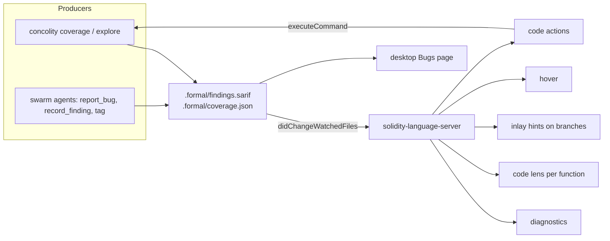

# Findings in the editor: concolity × solidity-language-server

The language server (github.com/asyncswap/solidity-language-server) already has what this needs: diagnostics, code
lenses, inlay hints, hover, code actions and `workspace/executeCommand`, on solc's AST. The Formal Mind desktop app
runs it too (the Code tab's Neovim, and `lsp.rs` for definition and hover). So what concolity and the swarm's agents
learn can sit on the lines it's about, in any editor, without a new protocol.

## One file, three readers

Producers write **SARIF 2.1.0** to `.formal/findings.sarif`. It's the standard for analysis results: GitHub code
scanning shows it on PRs, the VS Code SARIF viewer reads it, and the desktop Bugs page can read it as well.
Coverage goes next to it as concolity's JSON (`coverage --json`), which per file has line hits and the hit counts of
both sides of every JUMPI.

A result carries:

| SARIF field | What goes in it |
|---|---|
| `ruleId` | `concolity/panic-0x11`, `concolity/dead-guard`, `concolity/missing-bytecode`, `swarm/finding`, `swarm/tag` |
| `level` | `error` (a finding with a failing test), `warning`, `note` |
| `locations` | `src/AsyncSwap.sol:446`, the narrowest statement |
| `message` | one sentence, as a report states it |
| `properties.inputs` | the solved arguments (`["1592598101", "0", "…"]`) and the harness (`MagicExploreTest::testFuzz_poke`) |
| `properties.evidence` | the revert reason, the named writes, the PoC path |
| `relatedLocations` | the PoC test, the Lean theorem that proves a guard dead |
| `fingerprints` | file + function + rule, so a result survives edits above it |

## What the language server shows

1. **Diagnostics.** Each result becomes a `Diagnostic` with `code` = `ruleId` and `source` = `concolity` or `swarm`, and
   its related locations as `relatedInformation`. A side that's unsat from every harness gets `DiagnosticTag.Unnecessary`,
   so the dead guard renders greyed out, the way unused code does.
2. **Code lens over each function** (the server knows function ranges from the AST): `lines 12/14 · sides 5/8 · 2
   solved · 1 dead · 1 finding`. Clicking it runs `concolity.explore` scoped to that function.
3. **Inlay hints on branch lines**: `⟂ false side never taken`, `solved: x = 0x5eed1e55`, `dead (unsat, 3 harnesses)`.
4. **Hover** on a line: how often it ran, both sides' counts, the explore outcome with its inputs and harness, and the
   finding's text with its evidence.
5. **Code actions**:
   - *Debug with these inputs*: runs `concolity debug … --arg …`, or opens the desktop debugger on that run.
   - *Write a PoC test*: a Foundry test with the inputs as constants, under `test/`.
   - *Explore this branch*: runs explore with this side as the only target.
   - *Acknowledge*: writes the result's suppression into the SARIF file, with a reason.
6. **`workspace/executeCommand`**: `concolity.coverage`, `concolity.explore { function }`, `concolity.debug { test, args }`.
   The server shells out to the `concolity` binary and republishes when the SARIF file changes.

## Agents tag code

The swarm's agents already file findings (`report_bug`, `record_finding`). Add a `tag` tool: an agent marks a line or a
function with a short note and a kind (`suspicion`, `assumption`, `invariant`, `todo`), for example "rounding here favours the
taker", "assumes the PoolManager is unlocked", "orderCount must equal the nodes in the level". Tags go to the SARIF file
as `swarm/tag` notes. The person sees them inline in the editor, can promote one to a finding or dismiss it, and the
next agent reads the open tags on the function before working on it.

## Work, by repository

| Repository | Work |
|---|---|
| concolity | `--sarif <path>` on coverage and explore (findings, dead guards, missing bytecode); per-function rollups in the JSON |
| formalmind desktop | the swarm's `report_bug` / `record_finding` / a new `tag` write SARIF too; the Bugs page reads it |
| solidity-language-server | watch `.formal/*.sarif` and `.formal/coverage.json`; diagnostics, lenses, inlay hints, hover, code actions and the three commands above |

The order that pays first: concolity's `--sarif`, then diagnostics plus hover in the language server. Those two put every
finding and dead guard on its line. Lenses, hints and actions build on the same data.
