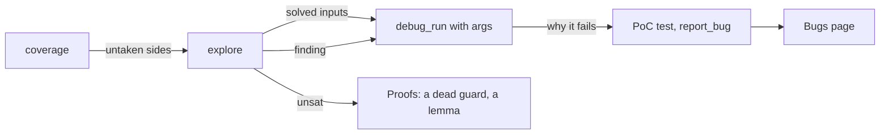

# Using concolity

concolity runs a Foundry project's tests in revm, on the bytecode solc produces with the project's own settings, and
tells you three things forge doesn't:

1. **coverage** that's honest about the shipped bytecode: lines and both sides of every `JUMPI`, measured on the
   optimized build, plus every call into an address with no code (an interface no test bound to an implementation);
2. **explore**: for every branch side no test takes, a solver tries to find inputs that take it, and reports the inputs,
   or proves the side can't be reached from that test;
3. **debug**: any test (a fuzz test with given inputs too) as JSON an agent can read: the Solidity lines it ran, every
   storage write by name, why and where it reverted, any step in full.

## Where it stands (2026-10-24)

| | |
|---|---|
| Test runner | Same verdicts as forge 1.8.6 on Async Swap's suite (836/836). On foundry's own cheatcode suite, 1 disagreement left of 297, on branch `claude/foundry-cheats-conformance-1a534c` of formalmind (isolation-mode gas). `--against-forge` checks any suite. |
| Coverage | forge's line rules (narrowest statement, function or modifier). Both sides of every JUMPI, on the optimized bytecode. Missing-bytecode bindings. lcov and JSON out. 48 s cold, 29 s warm on Async Swap (forge: 65 s). |
| Fuzzing | Each fuzz test runs `fuzz_runs` random inputs (default 32; `vm.assume` rejections are counted). Not forge's RNG or seed, no shrinking, and no invariant campaigns yet: invariant tests are reported as skipped. |
| Concolic | Every EVM opcode modelled, every result self-checked against revm (0 mismatches on Async Swap). Calldata is symbolic; storage, memory, returndata and transient storage follow it. Values the model can't keep symbolic (storage slots from a symbolic mapping key, call targets) are fixed to the run's value and reported as "unsat under pinned values". |
| Solver | z3 (`brew install z3`), 1 s per query by default, memory capped at 4 GB. |

## Install

```sh
git clone https://github.com/formalmind/concolity && cd concolity
cargo build --release          # target/release/concolity
brew install z3                # for explore
```

It uses the solc versions svm installed (the ones forge downloads: run `forge build` once if a version is missing), picked per file
from the pragmas of its import closure. Compiles are cached in `~/.cache/formalmind/solc`.

## coverage

```sh
concolity coverage path/to/project                         # summary: tests, per-file lines and sides, missing bytecode
concolity coverage . --skip test/formal/Slow.t.sol         # leave out test files whose path contains this
concolity coverage . --include src/libraries/              # report only these files
concolity coverage . --lcov lcov.info                      # editor gutters
concolity coverage . --bindings                            # every call site and what ran there
concolity coverage . --fast                                # optimizer off, like forge coverage (not the shipped code)
concolity coverage . --json > coverage.json                # everything, for agents and tools
concolity coverage . --sarif .formal/findings.sarif       # failing tests, missing bytecode, untaken sides, for editors
concolity coverage . --at src/libraries/AsyncFiller.sol:271   # each side's hit count on one line (cached: instant)
forge test --json > forge.json && concolity coverage . --against-forge forge.json   # where the runner and forge disagree
```

Read the summary bottom-up: **missing bytecode** first (a test that calls an interface with nothing behind it tests
nothing past that call), then the files with untaken sides.

## explore

```sh
concolity explore .                                        # every untaken side of src/, every fuzz test as a harness
concolity explore . --target src/AsyncSwap.sol:446         # only the untaken sides on that line
concolity explore . --only ReduceMatchedOrders             # only fuzz tests whose Contract::name contains this
concolity explore . --timeout-ms 20000                     # a deep equation (256-bit multiplication) needs longer
concolity explore . --json                                 # every side with its outcome, and the findings
concolity explore . --sarif .formal/findings.sarif        # findings, unreachable and solved sides (merged into the file)
CONCOLITY_DEBUG=1 concolity explore . --only X            # print each run's decisions and pins
```

Each untaken side ends as one of:

| Outcome | Meaning | What to do |
|---|---|---|
| **solved** | inputs that take the side, from a named fuzz test | `debug --arg` them to see the path; if it's a guard, it's now covered |
| **finding** | solved inputs that make the test fail | a bug or a test bug: open it in the debugger, write the PoC |
| **unsat** | no input of that test reaches the side | a dead guard, or the test can't express the case (its harness fixes the value) |
| **unsat under pinned values** | unreachable with the storage/call values this run had | widen the test's state, or wait for symbolic storage keys |
| **unknown** | the solver ran out of time | raise `--timeout-ms` |
| **inputs don't reach** | a fuzz test runs the code but its inputs don't decide the branch | the branch depends on state, not arguments: a stateful harness |
| **not reached** | no fuzz test runs the code at all | write a fuzz test for that function |

## debug

```sh
concolity debug . test/AsyncSwap.t.sol AsyncSwapTest::test_swap_createsOrderWithPrice            # verdict, calls, events
concolity debug . test/AsyncSwap.t.sol AsyncSwapTest::test_swap_createsOrderWithPrice lines --text --function beforeSwap
concolity debug . test/AsyncSwap.t.sol AsyncSwapTest::test_swap_createsOrderWithPrice writes --var orderCount
concolity debug . test/AsyncSwap.t.sol AsyncSwapTest::test_x revert                             # decoded reason and where
concolity debug . test/AsyncSwap.t.sol AsyncSwapTest::test_x step --n 1200                      # one step in full
concolity debug . test/Explore.t.sol 'MagicExploreTest::testFuzz_poke' revert --arg 1592598101 --arg 0 --arg 115792089237316195423570985008687907853269984665640564039457584007913129639929
```

## In the Formal Mind desktop app

The local swarm's agents have the same capabilities as tools, and they drive them; you watch.

| Tool | What the agent does with it |
|---|---|
| `debug_open` | compile a test file, list its tests |
| `debug_run` | run a test (a fuzz test with `args`), stop at its first statement |
| `debug_move` | `over`, `into`, `out`, `op`, `continue`, `first`, `last`, `search`, `step`, `pc`, each forwards or `back` |
| `debug_break`, `debug_watch` | a line breakpoint; stop on writes to a storage variable |
| `debug_look` | `here`, `summary`, `lines`, `revert`, `writes`, `step` |
| `coverage` | uncovered lines and untaken sides per file, failing tests, missing bytecode |
| `explore` | solved / unsat / unknown sides by line, and findings |

| `tag` | mark a line with a suspicion, assumption, invariant or todo (in `.formal/findings.sarif`) |

When an agent opens its debugger, the Swarm page shows it, read-only, moving as the agent moves.

**The hunter.** On the Bugs page, *Hunt for bugs* (with an optional focus such as `Router.swap`) queues a hunt. The
hunter runs coverage, then explore on the fuzz tests that reach the security-relevant gaps, debugs each finding and
solved side, and for each bug it can prove writes a Foundry PoC and files it with `report_bug`. Bugs land on the Bugs
page and, with tags, in `.formal/findings.sarif`, which solidity-language-server shows on the line.



## What it can catch today

Every item is a concrete run with reproducible inputs, never a model guess.

- **Reachable checked-arithmetic failures**: the Panic 0x11 / 0x12 side of solc's overflow and division checks is a
  target like any other. On the fixtures, explore finds `z + 7` and `a + b` overflowing from solver-chosen inputs.
- **Magic values and exact equations** random fuzzing misses (`x == 0x5eed1e55 && 3 * y == z + 7`), then the `assert`
  behind them.
- **Dead guards**: a side that's unsat for every harness is code no input reaches. On Async Swap, two of
  `_matchAmounts`' guards are dead by arithmetic (gas on every match).
- **Tests that test nothing past a call**: an interface call with no bytecode behind it (missing bindings).
- **Test-design gaps**: an unsat side from one harness says the harness fixes the value that decides the branch.
- **Wrong verdicts**: `--against-forge` turns forge into an oracle for the runner, and the runner for the suite.
- **Storage written where it shouldn't be**: `debug writes` names every write through mappings, structs and arrays
  (`priceBooks[0x3e76…].askLevels[886760].orderCount: 0 → 1`), so a write to the wrong slot shows up by name.
- **Transient-state leaks across calls in one transaction**: found by running what forge isolates (Async Swap's
  pending-match id; fixed in asyncswap/contracts#32).

Next, in [ROADMAP.md](../ROADMAP.md) and [HUNTING.md](../HUNTING.md): silent wraps in `unchecked`, assembly and Huff
(overflow queries on unchecked arithmetic), truncation and dirty upper bits, packed-slot corruption (bytes outside the
written field), symbolic storage keys, invariant campaigns and shrinking.
